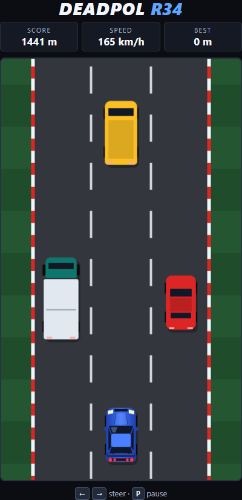

# DeadPol R34

A 2D top-down traffic-dodging game built with plain HTML, CSS, JavaScript, and HTML5 Canvas. No frameworks, no build step, no external assets.

**[Play the live demo](https://deadpol8789.github.io/deadpol-r34/)**

You drive an R34-inspired coupe down a three-lane road. Traffic keeps coming, the road keeps getting faster, and the round ends on the first crash.



## How to launch

The game is a static page, so there is nothing to install.

- **Online:** play it at <https://deadpol8789.github.io/deadpol-r34/> with touch or keyboard.
- **Locally:** open `index.html` in a modern browser (Chrome, Edge, Firefox).
- **With a local server** (optional, closer to how it will be hosted):

  ```
  python -m http.server 8000
  ```

  Then open `http://localhost:8000`. The VS Code "Live Server" extension works too.

All paths are relative. The demo is served by GitHub Pages straight from the root of the `main` branch, with no build step.

## Controls

| Key | Action |
| --- | --- |
| `←` `→` (or `A` `D`) | Steer left / right |
| `Enter` or `Space` | Start, resume, play again |
| `P` or `Esc` | Pause / resume |

On a touchscreen, tap **Start** and hold either on-screen arrow to steer. Release it to stop steering. Tap **Play again** after a crash or **Resume** after returning to a paused game. You can also click the screen buttons with a mouse.

## Scoring

- The score is the **distance driven, in metres**. It grows with the road speed, so later seconds are worth more than early ones.
- The road starts at about 96 km/h and accelerates steadily up to about 192 km/h.
- The score stops at the moment of the crash and is shown on the Game Over screen.
- The best score is saved in the browser with `localStorage`. If storage is not available, the game still works and the best score lasts until the page is closed.

## How it works

Everything lives in `js/game.js`, split into numbered sections.

### Game loop

One `requestAnimationFrame` loop is started when the page loads and runs for the whole life of the page. Each frame it:

1. measures `dt`, the time in seconds since the previous frame;
2. calls `update(dt)` to move things;
3. calls `render()` to draw the frame.

Every movement is `speed × dt`, with speeds in pixels per second, so the game plays the same on a 60 Hz and on a 240 Hz monitor. `dt` is capped at 0.05 s, so a long freeze cannot make cars jump through each other.

A `game.state` value (`"start"`, `"playing"`, `"gameover"`) decides what `update` does. Restarting only resets the data (`startGame()`); it never starts a second loop.

If the window loses focus or the tab is hidden, the pressed keys are released and the round is paused, so nothing gets stuck and nothing jumps when you come back.

### Traffic

Traffic appears in **waves** (rows of one or two vehicles), spaced by distance travelled instead of by frame count. Three rules keep it fair:

- A wave never blocks all three lanes.
- One "safe lane" is always left empty, and it moves at most one lane from one wave to the next, so you never have to cross the whole road in a single gap.
- All traffic moves at the same speed, so the gap created when a wave spawns never closes.

The gap between waves is the length of the wave, plus the length of the player's car, plus the distance traffic covers during a "clear time". That time shrinks from 1.25 s to 0.8 s as the round goes on, and double waves become more common. Changing one lane takes about 0.3 s.

### Collisions

Each vehicle is treated as a rectangle (axis-aligned bounding box). Two rectangles collide when they overlap on the horizontal axis **and** on the vertical axis at the same time (`boxesOverlap`). Every frame the player's rectangle is checked against every traffic vehicle.

The collision rectangles are a few pixels smaller than the drawings, so a near miss past a rounded corner or a mirror does not count as a crash.

## Project structure

```
index.html      Page, HUD and overlay screens
css/style.css   Layout and responsive sizing
js/game.js      Game logic and Canvas drawing
assets/images/  README screenshot (the game itself loads no image files)
```

## Art and assets

All graphics are drawn with Canvas shapes written for this project. The player car is an original design inspired by the general silhouette of the Nissan Skyline R34. No third-party sprites, logos, fonts, or sounds are used. This is a fan-made learning project and is not affiliated with or endorsed by Nissan.

## Technologies

- HTML5
- CSS3
- JavaScript (no libraries)
- HTML5 Canvas

## Possible next steps

- Sound effects
- More vehicle types and scenery

## Learning purpose

This project is also a learning exercise focused on JavaScript fundamentals and basic game development.

## Author

Created by [DeadPol8789](https://github.com/DeadPol8789).


## License

The game source code (HTML, CSS, and JavaScript) is licensed under the [MIT License](LICENSE). The screenshot in `assets/images/gameplay.png` is excluded from this license.
